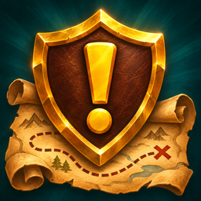

# Leveling Advisor

A leveling guide addon for WoW: Forever. It reads your character's level, zone, class and quest log, and recommends which quests to do next, which dungeons are worth running, and where to go, so you do not have to look anything up. Built for players with many alts.

Status: working addon with a full in-game book. It has a bookmark tab on the Map & Quest Log, zone routes, quest details with items and a mini map, a right-click menu, search, and map pins. The data is built from QuestieDB Forever, outof.games, OpenMap and an in-game census of map sizes (full build, not provisional).

## Features

- **The book.** A two-page window with the recommended zones and your dungeon on the left and the quests on the right. Open it with `/advisor`, the key binding, or the Leveling Advisor bookmark on the Map & Quest Log.
- **Zone routes.** Pick a zone to see a step-by-step route. Each step lists the quests to pick up, do and turn in there, and the XP it is worth.
- **Dungeon pages.** A "Before You Go" list of the quests to pick up on your way, the dungeon entrance and its level range.
- **Level fit.** Only yellow and green quests are recommended, and the zones and routes are the ones that fit your level. Quests that are too high wait in a collapsed "Later — too high for now" list, each with the level at which it gets good. A zone with many green quests you skipped says "Catch up".
- **The guide.** A waypoint to the next step of your top zone's route, set automatically and moved as you go, even with the book closed. Show on Map, a map pin click or a waypoint of your own pauses it (it never overrides your waypoint), and "Continue with waypoint" resumes it. Turn it on or off and continue from the minimap button's right-click menu, the book's main page, or `/advisor guide`.
- **Quest details.** Why the quest is recommended, its chain and XP, the items it provides, requires and rewards (with item tooltips), and a mini map of the zone. The mini map marks the giver, the turn-in and the objectives. Hover a marker for its name; an objective dot also says the item or creature, how many you need, where items drop and your progress. Click a marker to set a waypoint.
- **Quest chains.** A quest's details show its Unlock Path: the quests that unlock it, in order, with what is done and where to start. On a dungeon's quest list a chain-link badge marks quests that need earlier quests; a grey badge means the chain cannot be finished.
- **Search.** Type part of a quest name to find it, with its zone and whether it is available to you.
- **Right-click menu.** Right-click any quest to show it on the map, link it to chat, or ignore it.
- **At the quest giver.** When a quest giver offers a quest the advisor recommends, a small "Recommended — take it" ribbon under the quest page says why (its list, zone route step or dungeon) and roughly how much XP it gives.
- **Map pins.** Small gold-rimmed shields with ! (pick up) or ? (turn in) mark recommended quests on the world map; hover for details, click for a waypoint.

## Install

1. Copy the `LevelingAdvisor` folder into your `Interface/AddOns` folder.
2. Restart the game client.

Release zips (`dist/LevelingAdvisor-<version>.zip`) already contain the `LevelingAdvisor` folder.

## Commands

| Command | What it does |
| --- | --- |
| `/advisor` | Open (or close) the book |
| `/advisor summary` | Print the recommendations in chat |
| `/advisor map <questID>` | Show a quest on the world map |
| `/advisor ignore <questID>` | Hide a quest on this character |
| `/advisor unignore <questID\|all>` | Show it again (or clear every ignored quest) |
| `/advisor settings` | Open the settings panel |
| `/advisor export` | Export recorder data |
| `/advisor about` | Version and data sources |
| `/advisor pins` | Count the map pins on the current map |
| `/advisor guide on\|off\|continue` | The guide: a waypoint to your next step (on by default, per character). It pauses when you remove or replace its waypoint or use Show on Map; `continue` resumes it; `off` removes its waypoint |
| `/advisor debug` | Diagnostics |
| `/advisor help` | List the commands |

The book also has a key binding (Options > Key Bindings > AddOns > Leveling Advisor) and a bookmark on the Map & Quest Log.

## Settings

- Include elite and group quests
- Recommend dungeons and their quests
- Show pins for all recommended quest givers
- Record quest data (local only)
- Show minimap button
- Mark recommended quests at quest givers
- Guide: set a waypoint to the next step automatically (per character)

## Recorder and export

The recorder is on by default and stays on your computer. It never sends anything by itself. It stores bounded lists of what you do while questing, so quest data can be improved later. Turn it off in the settings.

`/advisor export` produces a text string you can share on purpose. It contains:

- the addon version and the game data version;
- quest IDs;
- the IDs of the NPCs that give the quests;
- the map ID and your x/y position when you talked to the quest giver;
- reward XP, and reward and choice item IDs;
- your **character level** at each sighting, and the XP a quest gave at that level;
- quest levels seen in gossip windows;
- how many times each quest was seen (`seen` counts);
- **Unix timestamps, to the second,** for each time you viewed a quest and each time you accepted one, and the order of accepted quests.

The recorder store is **account-wide**: data from all of your characters is combined in one list. It contains no character name, realm or account information, so entries cannot be tied to a particular character.

## Credits and data sources

- **Questie** and **QuestieDB** (https://github.com/Questie/Questie, https://github.com/Questie/QuestieDB, GPL-3.0). The data pipeline imports QuestieDB's WoW: Forever quest, NPC and object data (including its Forever trace data from players' sessions) and Questie's quest blacklist. Because of this, Leveling Advisor is released under the same license. Leveling Advisor is not affiliated with Questie and does not use its name or logo as branding.
- **outof.games**: WoW: Forever quest, NPC and map data. The data pipeline crawls it politely: `robots.txt` is respected, there is at most one request every 2 seconds, and responses are cached.
- **OpenMap** (https://github.com/openmap-world/openmap, MIT): dungeon names and entrances, Group Finder level ranges, boat and zeppelin routes, and zone level ranges, used in the built data. See `NOTICE.md`.
- **In-game census**: zone map sizes and rects measured in the game client.
- **Your own recorder**: data recorded in-game by players.

The license notices and credits for this data are in `NOTICE.md`; where each dataset came from is recorded in the source repository (`data/REFERENCE_SOURCES.md`, `data/QUESTIE_SOURCE.md`).

## License

GPL-3.0. See `LICENSE`.

## Development

- Tests: `busted` (Lua 5.1 / LuaJIT; specs live in `spec/`).
- Syntax check: `tools/check-lua-syntax.sh LevelingAdvisor`.
- Install into the game folder: `tools/deploy.sh LevelingAdvisor`.
- Release build: `tools/build.sh` runs the syntax check and tests, requires the generated `Data/` files, and writes `dist/LevelingAdvisor-<version>.zip`. A build whose `Data/Meta.lua` says `provisional = true` is named `-provisional` and prints a warning. Use `--allow-missing-data` to build without data; that zip is named `-nodata` and is for testing only.
- `pipeline/` is the data pipeline: it imports the QuestieDB Forever database, crawls outof.games (cached in `data/`), places OpenMap's dungeon entrances and boat and zeppelin docks on the census zone maps, and writes `LevelingAdvisor/Data/*.lua`. Its tests run with `pytest pipeline/tests`.
